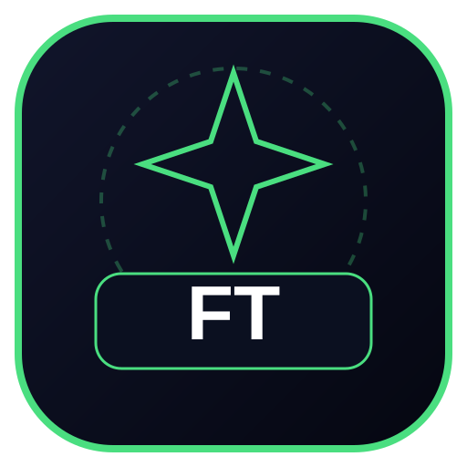

<p align="center">
  
</p>

# Golden Compass — Interface Prototype

A mobile-first fintech interface prototype exploring a digital investment experience, with a dark visual theme, portfolio-oriented screens, and compact navigation.

## Overview

The repository contains a standalone HTML prototype with its styling and client-side interactions in one file.

## Run Locally

No package installation is required.

1. Clone the repository.
2. Open `golden-compass.html` in a modern browser.

For local server testing:

```bash
python -m http.server 8000
```

Then open `http://localhost:8000/golden-compass.html`.

## Scope

This is a frontend prototype. The presence of interface screens does not imply a connected backend, live market data, real-money transactions, or brokerage execution.
